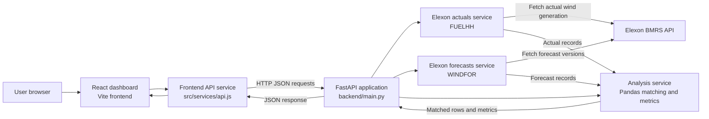

# WATTWISE

**UK Wind Power Forecast Analytics Dashboard**

WATTWISE is a pilot dashboard for comparing UK wind generation with published wind forecasts over January 2026. It retrieves data from the Elexon BMRS API, matches actuals with forecasts eligible at a configurable UTC decision cutoff, and presents forecast errors and accuracy metrics.

> The dashboard currently requests analysis for 1–2 January 2026. Its January date label is informational; date-range selection is not implemented in the frontend.

## Table of contents

- [Project overview](#project-overview)
- [Architecture](#architecture)
- [Features](#features)
- [Forecast analysis methodology](#forecast-analysis-methodology)
- [Technology stack](#technology-stack)
- [Project structure](#project-structure)
- [Local development](#local-development)
- [Docker](#docker)
- [API reference](#api-reference)
- [Data source and limitations](#data-source-and-limitations)
- [Deployment](#deployment)
- [Repository overview](#repository-overview)
- [Known limitations](#known-limitations)
- [Future improvements](#future-improvements)
- [Demo video](#demo-video)
- [AI tools used](#ai-tools-used)

## Project overview

WATTWISE focuses on UK wind generation data for January 2026. The frontend requests forecast analysis from the FastAPI backend and shows matched hourly actual and forecast values, a forecast-error chart, summary metrics, and a CSV export.

The interface is a historical pilot and decision-support view. It does not calculate total electricity demand or residual demand.

## Architecture

WATTWISE uses a small two-service architecture: a React single-page frontend requests data from a FastAPI backend, which retrieves records from the external Elexon BMRS API and performs the forecast analysis. There is no database in the current implementation.



### Components and responsibilities

| Component | Responsibility |
| --- | --- |
| **React frontend** (`frontend/src/`) | Renders the dashboard, requests the fixed 1–2 January 2026 analysis, displays summary metrics and Recharts visualizations, and exports the loaded comparison rows to CSV. |
| **Frontend API service** (`frontend/src/services/api.js`) | Builds HTTP requests to the configured `VITE_API_BASE_URL`, including query parameters, and parses JSON responses. |
| **FastAPI application** (`backend/main.py`) | Exposes health, raw data, and analysis endpoints; validates requested dates; calls the backend services; and returns JSON or HTTP errors. |
| **Elexon services** (`backend/elexon_service.py`, `backend/forecast_service.py`) | Retrieve FUELHH actual wind records and WINDFOR forecast records from the Elexon BMRS API. |
| **Analysis service** (`backend/analysis_service.py`) | Normalizes timestamps and values, aggregates actuals to hourly values, selects forecasts published before the configured cutoff, and calculates forecast errors and metrics. |
| **Docker Compose** (`docker-compose.yml`) | Builds and runs the backend API and the static frontend as separate services. |

### Analysis request flow

1. On page load, the dashboard requests `GET /api/analysis` for **1–2 January 2026** through the frontend API helper.
2. FastAPI validates the date range, fetches actual generation, and fetches forecast records covering the requested end date and up to two preceding publication days.
3. The analysis service aggregates half-hourly actuals into hourly values, selects the latest forecast published by the previous-day UTC cutoff, and scores only matching hours.
4. FastAPI returns the analysis period, matched rows, match count, cutoff, MAE, RMSE, and bias as JSON.
5. The frontend uses those rows for its generation and error charts, derives its summary cards, and offers the same loaded rows for CSV export.

The browser communicates with FastAPI over HTTP; the backend makes outbound HTTP requests to Elexon. The analysis endpoint currently performs actual and forecast retrieval before calling the analysis service. Raw actuals and forecasts are also available through their own API endpoints.

### Container layout

In Docker Compose, the backend container runs Uvicorn on port `8000` and publishes it on host port `8000`. The frontend image builds the Vite application with Node, then serves the generated static files from Nginx on container port `80`, published as host port `3000`. The frontend API base URL is embedded at build time; in the provided local Compose configuration it is `http://localhost:8000`.

## Features

- **Wind generation dashboard:** Displays analysis of actual and forecast wind generation in MW.
- **Elexon data retrieval:** The backend fetches actual wind generation and WINDFOR forecast records from Elexon's BMRS API.
- **Eligible-forecast comparison:** For each delivery hour with actual data, analysis selects the latest forecast published by the configured cutoff on the preceding UTC day.
- **Accuracy metrics:** Reports mean absolute error (MAE), root mean square error (RMSE), and signed forecast bias for matched records.
- **Charts:** Recharts line chart compares hourly actual generation and the selected forecast; a bar chart displays signed forecast error.
- **CSV export:** The dashboard can export the currently loaded analysis rows, including timestamps, actuals, forecasts, publication times, and errors.
- **Backend health and API docs:** Provides a health endpoint and FastAPI-generated interactive API documentation.
- **Containerized local setup:** Docker Compose runs the frontend and backend services together.

## Forecast analysis methodology

Analysis is implemented in `backend/analysis_service.py`:

1. Parses timestamps as UTC and converts generation values to numbers; invalid records are omitted.
2. Groups half-hourly actual records by their floored UTC hour and averages each group to an hourly actual generation value.
3. Matches forecast delivery hours to hours with actual generation.
4. For each delivery hour, calculates the cutoff on the preceding UTC day at `decision_hour_utc`. It excludes forecasts published after that cutoff and selects the most recently published eligible forecast.
5. Compares only delivery hours with both an hourly actual and an eligible forecast.
6. Calculates error as **forecast minus actual**, then calculates metrics over those matched errors.

The default decision hour is **11:00 UTC**. This is a configurable analytical assumption in this implementation, not a claim about an officially verified UK market rule. Confirm the applicable deadline before relying on this setting operationally.

| Metric | Calculation and interpretation |
| --- | --- |
| MAE | Mean of the absolute forecast errors. It describes the average error magnitude. |
| RMSE | Square root of the mean squared forecast errors. Squaring gives larger errors more influence. |
| Bias | Mean of the signed errors (`forecast - actual`). Positive values indicate overforecasting; negative values indicate underforecasting. |

The analysis response rounds these metrics to two decimal places. Its `count` and metrics apply only to delivery hours that have both actual data and an eligible forecast.

## Technology stack

| Area | Technologies used |
| --- | --- |
| Frontend | React, JavaScript, Vite, CSS, Recharts, Lucide React |
| Backend | Python, FastAPI, Uvicorn, Pandas, HTTPX |
| Containers | Docker, Docker Compose, Nginx (production frontend image) |
| Data API | Elexon BMRS API |

`requests` is listed in the backend requirements, although the current data-fetching services use HTTPX.

## Project structure

```text
power-project/
├── backend/
│   ├── analysis_service.py
│   ├── check_forecast.py
│   ├── elexon_service.py
│   ├── forecast_service.py
│   ├── main.py
│   ├── requirements.txt
│   ├── Dockerfile
│   └── .dockerignore
├── frontend/
│   ├── public/
│   │   └── favicon.svg
│   ├── src/
│   │   ├── components/
│   │   │   └── charts/
│   │   │       ├── ErrorChart.jsx
│   │   │       └── GenerationChart.jsx
│   │   ├── services/
│   │   │   └── api.js
│   │   ├── App.css
│   │   ├── App.jsx
│   │   ├── index.css
│   │   └── main.jsx
│   ├── index.html
│   ├── package.json
│   ├── package-lock.json
│   ├── vite.config.js
│   ├── Dockerfile
│   ├── .dockerignore
│   └── .gitignore
├── docker-compose.yml
└── .gitignore
```

`backend/test_forecast.py` is also present; it retrieves and prints a few forecast records as a manual inspection script. No automated test suite is documented here.

## Local development

Run the backend and frontend in separate PowerShell terminals from the project root.

### Backend

```powershell
cd backend
python -m venv .venv
.\.venv\Scripts\Activate.ps1
pip install -r requirements.txt
uvicorn main:app --reload
```

If PowerShell blocks virtual-environment activation, allow scripts for the current process with `Set-ExecutionPolicy -Scope Process -ExecutionPolicy Bypass`, then activate again.

The backend listens at `http://localhost:8000`. Interactive Swagger documentation is at `http://localhost:8000/docs`.

### Frontend

In another terminal, from the project root:

```powershell
cd frontend
npm install
npm run dev
```

Vite's default development URL is `http://localhost:5173` (unless that port is occupied, in which case Vite may select another port). The backend CORS configuration currently allows `http://localhost:5173`.

The frontend API service reads `VITE_API_BASE_URL`; it defaults to `http://127.0.0.1:8000`. To use another backend in PowerShell, set the variable before starting Vite:

```powershell
$env:VITE_API_BASE_URL = "http://localhost:8000"
npm run dev
```

## Docker

From the project root, build and start both services:

```powershell
docker compose up --build -d
```

Useful commands:

```powershell
docker compose ps
docker compose logs --tail=60 backend
docker compose down
```

Local container URLs:

| Service | URL |
| --- | --- |
| Frontend | `http://localhost:3000` |
| Backend | `http://localhost:8000` |
| API documentation | `http://localhost:8000/docs` |

The backend Dockerfile installs Python requirements and starts Uvicorn on port 8000. The frontend Dockerfile builds the Vite app with Node, then serves the static build using Nginx on port 80, mapped to port 3000 on the host. Docker Compose builds and connects the two services and passes `VITE_API_BASE_URL` as a frontend build argument. The `.dockerignore` files exclude local or generated files from their respective Docker build contexts.

## API reference

The API is implemented in `backend/main.py`. Date parameters are ISO-formatted dates (`YYYY-MM-DD`); date validation rejects reversed ranges and dates outside **1–31 January 2026**.

| Method and path | Query parameters and defaults | Description |
| --- | --- | --- |
| `GET /` | None | Returns an API-running message. |
| `GET /api/health` | None | Returns `{"status":"ok"}`. |
| `GET /api/actuals` | `start_date=2026-01-01`, `end_date=2026-01-02` | Returns a `count` and `data` list of actual wind-generation records. |
| `GET /api/forecasts` | `start_date=2026-01-01`, `end_date=2026-01-03` | Returns a `count` and `data` list of wind forecast records. |
| `GET /api/analysis` | `start_date=2026-01-01`, `end_date=2026-01-02`, `decision_hour_utc=11` | Returns the requested `period`, matched record count, metrics, cutoff, and comparison data. The decision hour must be an integer from 0 through 23. |

For actuals and forecasts, the requested date range is passed to the respective Elexon retrieval service. Analysis fetches actuals for the requested range and forecasts from up to two days before the start date (bounded below at 1 December 2025) through the end date, so it can find forecasts published before delivery cutoffs.

Example local requests:

- Health: `http://localhost:8000/api/health`
- Swagger UI: `http://localhost:8000/docs`
- Analysis: `http://localhost:8000/api/analysis?start_date=2026-01-01&end_date=2026-01-02&decision_hour_utc=11`
- Actuals: `http://localhost:8000/api/actuals?start_date=2026-01-01&end_date=2026-01-02`
- Forecasts: `http://localhost:8000/api/forecasts?start_date=2026-01-01&end_date=2026-01-03`

Data-fetch or analysis failures are returned as HTTP 502 responses; invalid date ranges return HTTP 400.

## Data source and limitations

- `backend/elexon_service.py` requests `FUELHH` records from `https://data.elexon.co.uk/bmrs/api/v1/datasets`, with `fuelType=WIND`, for actual generation.
- `backend/forecast_service.py` requests `WINDFOR` records from the same Elexon BMRS API, using a UTC publication-time range. It keeps records with a delivery `startTime` in January 2026.
- The analysis and frontend focus on January 2026; the API enforces that month for requested delivery dates.
- The dashboard depends on the external API being reachable and returning usable records. If data retrieval fails, the API reports an error and the dashboard shows an error message.
- The cutoff hour is configurable but currently defaults to 11:00 UTC. Treat it as an analytical assumption, not a verified market rule.
- Metrics describe only the matched actual/eligible-forecast records in the requested analysis period; they are not necessarily based on every hour in that period.
- There is no database configured; records are retrieved from the external API when requested.

## Deployment

### Docker deployment

The repository provides Dockerfiles for both services and a Docker Compose configuration for local containerized operation. Build and start them with:

```powershell
docker compose up --build -d
```

### Cloud deployment status

**Cloud deployment is pending; no deployed URL is configured in the repository.** For a cloud deployment, build the frontend with `VITE_API_BASE_URL` set to the deployed backend's publicly reachable base URL. The current frontend reads this value at build time. Configure FastAPI CORS to allow the deployed frontend origin; the current allowlist contains only localhost development origins.

## Repository overview

This repository contains the WATTWISE dashboard, FastAPI data and analysis API, and Docker Compose setup. The root `README.md` is the project-level setup and reference guide.

## Known limitations

- The API and forecast filtering are limited to January 2026.
- The frontend loads a fixed 1–2 January 2026 analysis period; its date display is not an interactive selector.
- Forecast eligibility uses a configurable cutoff assumption whose appropriateness should be verified before operational use.
- Results depend on Elexon API availability and on records being available and matching across actual and forecast data.
- Automated tests are not represented by the current `backend/test_forecast.py` script, which is a manual data-fetch inspection utility.
- No cloud deployment or production CORS configuration is included.

## Future improvements

These are proposals, not currently implemented features:

- Support a broader, validated date range and add interactive date selection.
- Add automated unit and integration tests for API behavior, forecast matching, and metric calculations.
- Improve retry, timeout, and user-facing error handling for external data retrieval.
- Make operational forecast cutoff configuration explicit and validate it against the applicable market requirements.
- Configure and document a cloud deployment, including environment-specific API URLs and CORS origins.

## Demo video

**Not yet available.** A demo video link can be added here when one exists.

## AI tools used

ChatGPT and GitHub Copilot are used as development assistance tools for tasks such as implementation guidance, debugging, code assistance, and documentation. They are aids to development and do not imply that all project code was AI-generated or that the project has been independently audited.
